<h1 align="center" id="top">Complete HTML Notes</h1>

## Table of Contents

1. [Introduction to HTML](#1-introduction-to-html)
   1. [What is HTML?](#what-is-html)
   2. [Why Do We Use HTML?](#why-do-we-use-html)
   3. [HTML History](#html-history)
   4. [HTML, CSS and JavaScript](#html-css-and-javascript)
   5. [How Does HTML Work?](#how-does-html-work)

2. [Creating Your First Website](#2-creating-your-first-website)
   1. [Installing VS Code](#installing-vs-code)
   2. [Creating an HTML File](#creating-an-html-file)
   3. [Basic HTML Structure](#basic-html-structure)
   4. [DOCTYPE Declaration](#doctype-declaration)
   5. [HTML, Head and Body](#html-head-and-body)
   6. [HTML Comments](#html-comments)
   7. [Case Sensitivity](#case-sensitivity)

3. [HTML Elements and Attributes](#3-html-elements-and-attributes)
   1. [HTML Tags](#html-tags)
   2. [HTML Elements](#html-elements)
   3. [Nested Elements](#nested-elements)
   4. [Empty Elements](#empty-elements)
   5. [HTML Attributes](#html-attributes)
   6. [Global Attributes](#global-attributes)
   7. [Block and Inline Elements](#block-and-inline-elements)

4. [HTML Text Elements](#4-html-text-elements)
   1. [Heading Tags](#heading-tags)
   2. [Paragraph Tag](#paragraph-tag)
   3. [Line Break Tag](#line-break-tag)
   4. [Horizontal Rule Tag](#horizontal-rule-tag)
   5. [Bold and Strong Tags](#bold-and-strong-tags)
   6. [Italic and Emphasis Tags](#italic-and-emphasis-tags)
   7. [Underline Tag](#underline-tag)
   8. [Small Tag](#small-tag)
   9. [Mark Tag](#mark-tag)
   10. [Delete and Insert Tags](#delete-and-insert-tags)
   11. [Subscript and Superscript](#subscript-and-superscript)
   12. [Pre Tag](#pre-tag)
   13. [Code and Keyboard Tags](#code-and-keyboard-tags)
   14. [Blockquote and Q Tags](#blockquote-and-q-tags)
   15. [Abbreviation Tag](#abbreviation-tag)

5. [HTML Links and Navigation](#5-html-links-and-navigation)
   1. [Anchor Tag](#anchor-tag)
   2. [External Links](#external-links)
   3. [Internal Page Links](#internal-page-links)
   4. [Target Attribute](#target-attribute)
   5. [Email Links](#email-links)
   6. [Telephone Links](#telephone-links)
   7. [Download Links](#download-links)
   8. [Links to Page Sections](#links-to-page-sections)
   9. [Image as a Link](#image-as-a-link)

6. [HTML Images](#6-html-images)
   1. [Image Tag](#image-tag)
   2. [Image Attributes](#image-attributes)
   3. [Image File Paths](#image-file-paths)
   4. [Absolute and Relative Paths](#absolute-and-relative-paths)
   5. [Figure and Figcaption](#figure-and-figcaption)
   6. [Lazy Loading](#lazy-loading)
   7. [Responsive Images](#responsive-images)
   8. [Picture and Source Tags](#picture-and-source-tags)

7. [HTML Lists](#7-html-lists)
   1. [Unordered List](#unordered-list)
   2. [Ordered List](#ordered-list)
   3. [Description List](#description-list)
   4. [Nested Lists](#nested-lists)

8. [HTML Tables](#8-html-tables)
   1. [Table Tag](#table-tag)
   2. [Table Rows and Cells](#table-rows-and-cells)
   3. [Table Headings](#table-headings)
   4. [Table Caption](#table-caption)
   5. [Colspan Attribute](#colspan-attribute)
   6. [Rowspan Attribute](#rowspan-attribute)
   7. [Table Sections](#table-sections)
   8. [Accessible Tables](#accessible-tables)

9. [HTML Forms](#9-html-forms)
   1. [Form Tag](#form-tag)
   2. [Label Tag](#label-tag)
   3. [Input Tag](#input-tag)
   4. [Input Types](#input-types)
   5. [Text and Password Inputs](#text-and-password-inputs)
   6. [Email and URL Inputs](#email-and-url-inputs)
   7. [Number and Range Inputs](#number-and-range-inputs)
   8. [Date and Time Inputs](#date-and-time-inputs)
   9. [Radio Buttons](#radio-buttons)
   10. [Checkboxes](#checkboxes)
   11. [File Input](#file-input)
   12. [Select and Option](#select-and-option)
   13. [Textarea](#textarea)
   14. [Button Tag](#button-tag)
   15. [Fieldset and Legend](#fieldset-and-legend)
   16. [Input Attributes](#input-attributes)
   17. [Form Attributes](#form-attributes)
   18. [Form Validation](#form-validation)

10. [HTML Layout and Semantic Elements](#10-html-layout-and-semantic-elements)
    1. [Div Tag](#div-tag)
    2. [Span Tag](#span-tag)
    3. [Header Tag](#header-tag)
    4. [Nav Tag](#nav-tag)
    5. [Main Tag](#main-tag)
    6. [Section Tag](#section-tag)
    7. [Article Tag](#article-tag)
    8. [Aside Tag](#aside-tag)
    9. [Footer Tag](#footer-tag)
    10. [Semantic HTML](#semantic-html)

11. [HTML Media](#11-html-media)
    1. [Audio Tag](#audio-tag)
    2. [Video Tag](#video-tag)
    3. [Source Tag](#source-tag)
    4. [Track Tag](#track-tag)
    5. [Iframe Tag](#iframe-tag)
    6. [Embedding YouTube Videos](#embedding-youtube-videos)

12. [HTML Head and Metadata](#12-html-head-and-metadata)
    1. [Title Tag](#title-tag)
    2. [Meta Charset](#meta-charset)
    3. [Viewport Meta Tag](#viewport-meta-tag)
    4. [Meta Description](#meta-description)
    5. [Meta Robots](#meta-robots)
    6. [Link Tag](#link-tag)
    7. [Favicon](#favicon)
    8. [Script Tag](#script-tag)
    9. [Base Tag](#base-tag)

13. [Important HTML Attributes](#13-important-html-attributes)
    1. [ID Attribute](#id-attribute)
    2. [Class Attribute](#class-attribute)
    3. [Style Attribute](#style-attribute)
    4. [Title Attribute](#title-attribute)
    5. [Hidden Attribute](#hidden-attribute)
    6. [Contenteditable Attribute](#contenteditable-attribute)
    7. [Data Attributes](#data-attributes)
    8. [Min and Max Attributes](#min-and-max-attributes)
    9. [Step Attribute](#step-attribute)
    10. [Readonly and Disabled](#readonly-and-disabled)
    11. [Autocomplete Attribute](#autocomplete-attribute)
    12. [Autofocus Attribute](#autofocus-attribute)
    13. [Required Attribute](#required-attribute)
    14. [Pattern Attribute](#pattern-attribute)

14. [HTML Entities](#14-html-entities)

15. [HTML Accessibility](#15-html-accessibility)
    1. [Alt Attribute](#alt-attribute)
    2. [Accessible Images](#accessible-images)
    3. [Accessible Forms](#accessible-forms)
    4. [ARIA Attributes](#aria-attributes)

16. [HTML SEO](#16-html-seo)
    1. [What is SEO?](#what-is-seo)
    2. [HTML and SEO](#html-and-seo)
    3. [SEO Friendly Headings](#seo-friendly-headings)
    4. [Meta Description for SEO](#meta-description-for-seo)
    5. [Image SEO](#image-seo)
    6. [Canonical Link](#canonical-link)

17. [Useful HTML Elements](#17-useful-html-elements)
    1. [Details and Summary](#details-and-summary)
    2. [Progress Tag](#progress-tag)
    3. [Meter Tag](#meter-tag)
    4. [Time Tag](#time-tag)
    5. [Address Tag](#address-tag)
    6. [Dialog Tag](#dialog-tag)
    7. [Template Tag](#template-tag)

18. [HTML Forms and Browser APIs](#18-html-forms-and-browser-apis)
    1. [Form Validation](#form-validation-api)
    2. [Input Validation States](#input-validation-states)
    3. [Custom Data Attributes](#custom-data-attributes)

19. [HTML Best Practices](#19-html-best-practices)

20. [Complete HTML Project](#20-complete-html-project)

21. [Important Questions and Answers](#21-important-questions-and-answers)

22. [Quick Revision](#22-quick-revision)

23. [Practice Tasks](#23-practice-tasks)

24. [Useful References](#24-useful-references)

---

# 1. Introduction to HTML

<a id="what-is-html"></a>

## What is HTML?

HTML stands for HyperText Markup Language.

HTML ek markup language hai jiska use web pages ka structure aur content create karne ke liye hota hai.

HTML browser ko batata hai ki webpage par heading, paragraph, image, link, table aur form jaise elements ko kaise organize karna hai.

HTML programming language nahi hai. Yeh webpage ka structure define karti hai.

**Example:**

```html
<h1>Welcome to My Website</h1>

<p>This is my first webpage.</p>
```

**Output:**

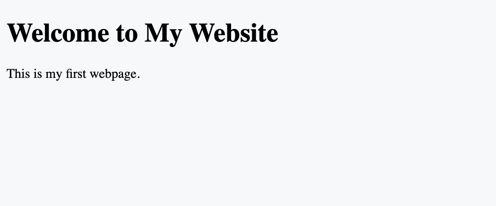

<!-- Add your output screenshot here. Recommended size: 600 × 250 px -->

<a id="why-do-we-use-html"></a>

## Why Do We Use HTML?

HTML ka use website ka basic structure create karne ke liye hota hai.

- Webpage par headings create karna.
- Paragraphs aur text add karna.
- Images display karna.
- Links create karna.
- Lists aur tables banana.
- Forms create karna.
- Website ka content organize karna.

<a id="html-history"></a>

## HTML History

HTML ko Tim Berners-Lee ne develop kiya tha.

| Year | Development |
|---|---|
| 1991 | HTML ka initial version |
| 1995 | HTML 2.0 |
| 1997 | HTML 3.2 |
| 1997 | HTML 4.0 |
| 1999 | HTML 4.01 |
| 2014 | HTML5 Recommendation |

Aaj HTML Living Standard ke through continuously develop hota rehta hai.

<a id="html-css-and-javascript"></a>

## HTML, CSS and JavaScript

Web development mein HTML, CSS aur JavaScript teen important technologies hain.

| Technology | Purpose |
|---|---|
| HTML | Website ka structure |
| CSS | Website ka design aur styling |
| JavaScript | Website ki functionality aur interaction |

**Example:**

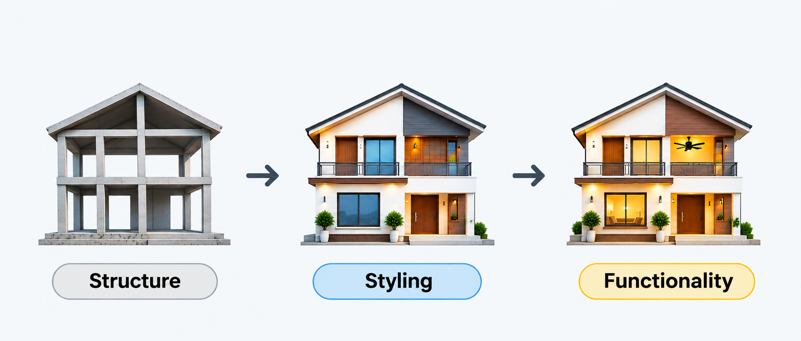

- HTML = Ghar ka structure.
- CSS = Paint, decoration aur design.
- JavaScript = Electrical system aur functionality.

<a id="how-does-html-work"></a>

## How Does HTML Work?

HTML browser ke through render hota hai.

1. Developer HTML code likhta hai.
2. HTML file save hoti hai.
3. Browser HTML file read karta hai.
4. Browser HTML elements ko process karta hai.
5. Webpage screen par display hota hai.

---

# 2. Creating Your First Website

<a id="installing-vs-code"></a>

## Installing VS Code

Visual Studio Code ek code editor hai jisme HTML, CSS aur JavaScript likh sakte hain.

HTML likhne ke liye VS Code compulsory nahi hai. Notepad jaise text editor mein bhi HTML likha ja sakta hai.

<a id="creating-an-html-file"></a>

## Creating an HTML File

HTML document create karne ke liye `.html` extension wali file banayi jaati hai.

Example:

```text
my-website/
│
├── index.html
├── about.html
├── contact.html
│
└── images/
    └── profile.jpg
```

`index.html` commonly website ka homepage hota hai.

<a id="basic-html-structure"></a>

## Basic HTML Structure

Har normal HTML document ka ek basic structure hota hai.

```html
<!DOCTYPE html>
<html lang="en">

<head>
    <meta charset="UTF-8">
    <meta name="viewport" content="width=device-width, initial-scale=1.0">

    <title>My First Website</title>
</head>

<body>

    <h1>Hello World!</h1>

    <p>This is my first HTML page.</p>

</body>

</html>
```

**Output:**

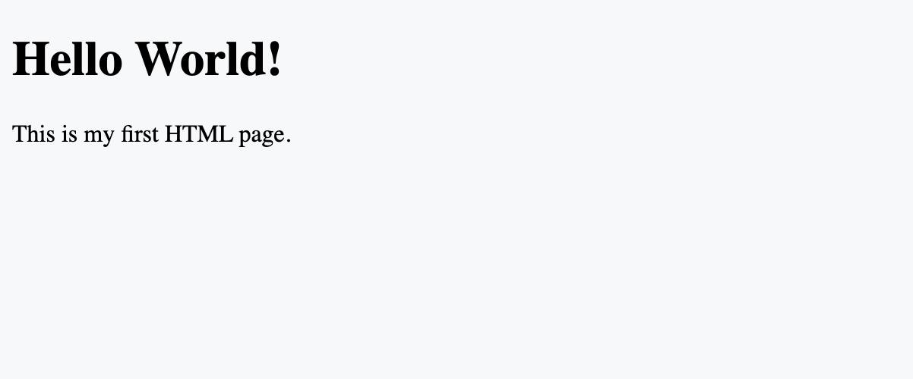

<!-- Add your output screenshot here. Recommended size: 600 × 250 px -->

<a id="doctype-declaration"></a>

## DOCTYPE Declaration

`<!DOCTYPE html>` browser ko batata hai ki document HTML5 standard ke according likha gaya hai.

```html
<!DOCTYPE html>
```

Is declaration ko HTML document ki first line mein likhna chahiye.

<a id="html-head-and-body"></a>

## HTML, Head and Body

HTML document ke main elements:

| Tag | Purpose |
|---|---|
| `<html>` | Complete document ka root element |
| `<head>` | Metadata aur page information |
| `<title>` | Browser tab ka title |
| `<body>` | Webpage ka visible content |

```html
<!DOCTYPE html>
<html>

<head>
    <title>My Website</title>
</head>

<body>
    <h1>Welcome</h1>
    <p>This is my webpage.</p>
</body>

</html>
```

**Output:**

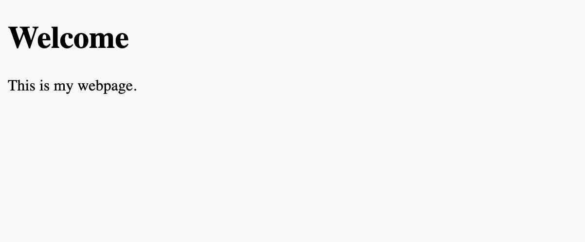

<!-- Add your output screenshot here. Recommended size: 600 × 250 px -->

<a id="html-comments"></a>

## HTML Comments

HTML comments ka use code mein notes aur explanations likhne ke liye hota hai.

Comments browser mein visible nahi hote.

```html
<!-- This is an HTML comment -->

<h1>My Website</h1>

<!-- This is a paragraph -->

<p>Hello World!</p>
```

<a id="case-sensitivity"></a>

## Case Sensitivity

HTML tags generally case-insensitive hote hain.

Lekin best practice hai ki tags aur attributes ko lowercase mein likho.

```html
<h1>Welcome</h1>

<p>Learning HTML</p>
```

<a id="parent-child-elements"></a>

## Parent and Child Elements

Jab ek element ke andar doosra element hota hai, toh outer element parent aur inner element child kehlata hai.

```html
<div>

    <h1>My Website</h1>

    <p>Welcome to my website.</p>

</div>
```

Yahan:

- `div` parent element hai.
- `h1` aur `p` child elements hain.

**Output:**

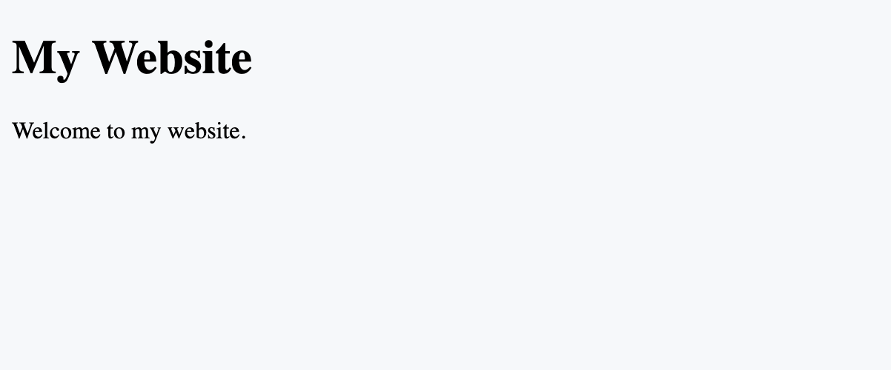

<!-- Add your output screenshot here. Recommended size: 600 × 250 px -->

---

# 3. HTML Elements and Attributes

<a id="html-tags"></a>

## HTML Tags

HTML tags angle brackets ke andar likhe jaate hain.

```html
<h1>Hello World</h1>
```

<a id="html-elements"></a>

## HTML Elements

Opening tag, content aur closing tag milkar ek HTML element bana sakte hain.

```html
<p>This is an HTML element.</p>
```

<a id="nested-elements"></a>

## Nested Elements

Jab ek HTML element ke andar doosra element hota hai, toh use nested elements kehte hain.

```html
<div>
    <h2>About Us</h2>

    <p>Welcome to our website.</p>
</div>
```

<a id="empty-elements"></a>

## Empty Elements

Kuch HTML elements ke andar content nahi hota. Inhe empty elements kehte hain.

```html
<br>

<hr>


```

<a id="html-attributes"></a>

## HTML Attributes

Attributes HTML elements ko additional information provide karte hain.

Attributes opening tag ke andar likhe jaate hain.

```html
<a href="https://www.google.com">Visit Google</a>


```

| Attribute | Purpose |
|---|---|
| href | Link destination |
| src | Resource location |
| alt | Image description |
| width | Width |
| height | Height |
| title | Additional information |

<a id="global-attributes"></a>

## Global Attributes

Global attributes most HTML elements par use kiye ja sakte hain.

| Attribute | Purpose |
|---|---|
| id | Unique identity |
| class | Elements grouping |
| title | Additional information |
| style | Inline styling |
| hidden | Element hide karna |
| lang | Language define karna |
| contenteditable | Content editable banana |
| tabindex | Keyboard focus order |

<a id="block-and-inline-elements"></a>

## Block and Inline Elements

HTML elements ko broadly block-level aur inline elements ke roop mein samjha ja sakta hai.

**Block-level elements:** Generally available width occupy karte hain aur new line se start hote hain.

Examples:

```html
<div>First Block</div>
<p>Second Block</p>
<h1>Heading</h1>
```

**Inline elements:** Generally sirf required content ki space occupy karte hain.

Examples:

```html
<span>Inline Text</span>

<a href="#">Click Here</a>

<strong>Important</strong>
```

**Output :**

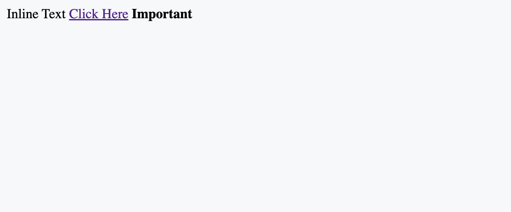


<!-- Add your output screenshot here. Recommended size: 600 × 250 px -->

---

# 4. HTML Text Elements

<a id="heading-tags"></a>

## Heading Tags

HTML mein six heading tags hote hain: `h1` se `h6` tak.

`h1` highest-level heading aur `h6` lowest-level heading hoti hai.

```html
<h1>Main Heading</h1>
<h2>Sub Heading</h2>
<h3>Section Heading</h3>
<h4>Heading Four</h4>
<h5>Heading Five</h5>
<h6>Heading Six</h6>
```

**Output :**

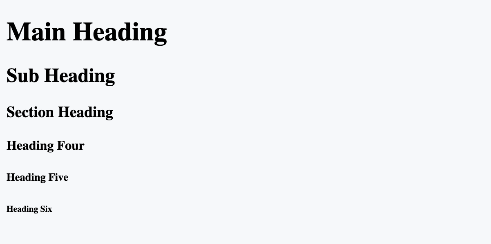

<!-- Add your output screenshot here. Recommended size: 600 × 300 px -->

<a id="paragraph-tag"></a>

## Paragraph Tag

`<p>` tag ka use paragraph likhne ke liye hota hai.

```html
<p>HTML is used to create webpage structure.</p>

<p>It is the foundation of web development.</p>
```

**Output :**

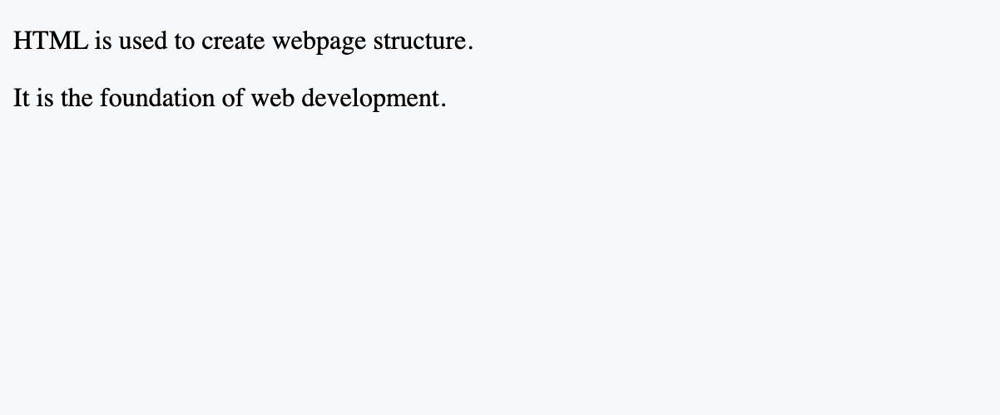

<!-- Add your output screenshot here. Recommended size: 600 × 200 px -->

<a id="line-break-tag"></a>

## Line Break Tag

`<br>` tag text ko next line mein shift karta hai.

```html
<p>
    My name is Sumit.<br>
    I am learning HTML.<br>
    I want to become a web developer.
</p>
```

**Output :**


<!-- Add your output screenshot here. Recommended size: 600 × 200 px -->

<a id="horizontal-rule-tag"></a>

## Horizontal Rule Tag

`<hr>` tag content ke beech thematic break create karta hai. Browser generally horizontal line display karta hai.

```html
<h2>About Us</h2>

<p>We are learning web development.</p>

<hr>

<h2>Our Services</h2>

<p>We create websites.</p>
```

**Output :**

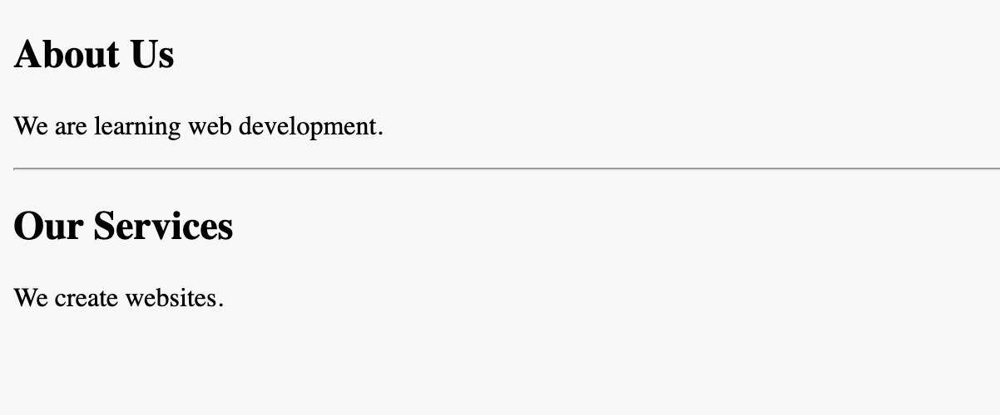

<!-- Add your output screenshot here. Recommended size: 600 × 250 px -->

<a id="bold-and-strong-tags"></a>

## Bold and Strong Tags

`<b>` text ko visually bold karta hai.

`<strong>` important text ko represent karta hai.

```html
<p>This is <b>bold text</b>.</p>

<p>This is <strong>important text</strong>.</p>
```

**Output :**

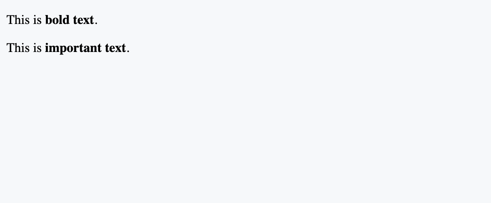

<!-- Add your output screenshot here. Recommended size: 600 × 150 px -->

<a id="italic-and-emphasis-tags"></a>

## Italic and Emphasis Tags

`<i>` alternate voice ya mood ko represent karta hai.

`<em>` text par emphasis provide karta hai.

```html
<p>This is <i>italic text</i>.</p>

<p>This is <em>emphasized text</em>.</p>
```

**Output :**

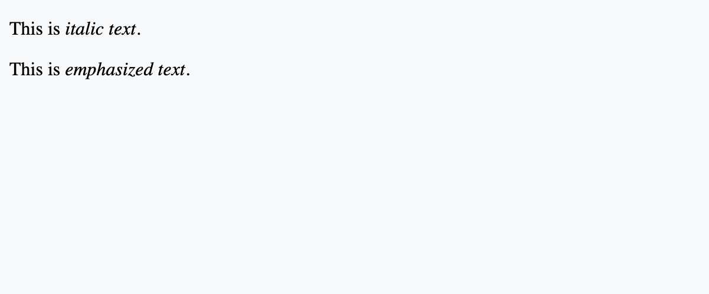

<!-- Add your output screenshot here. Recommended size: 600 × 150 px -->

<a id="underline-tag"></a>

## Underline Tag

`<u>` text ko underline karta hai.

```html
<p>This is <u>underlined text</u>.</p>
```

**Output :**

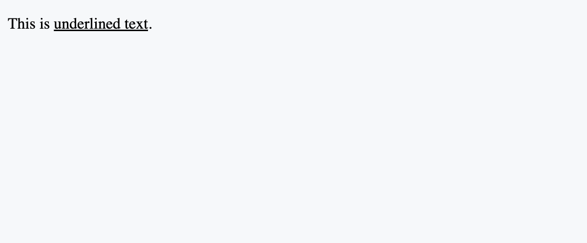

<!-- Add your output screenshot here. Recommended size: 600 × 150 px -->

<a id="small-tag"></a>

## Small Tag

`<small>` tag small text ko represent karta hai.

```html
<p>Normal text</p>

<p><small>Small text</small></p>
```

**Output :**

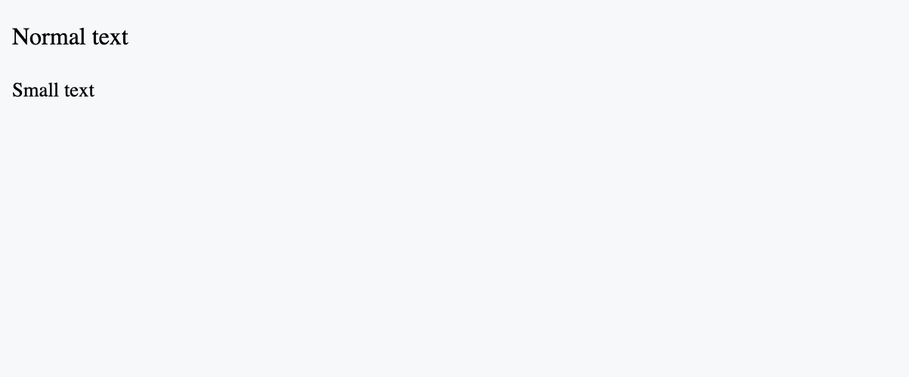

<!-- Add your output screenshot here. Recommended size: 600 × 150 px -->

<a id="mark-tag"></a>

## Mark Tag

`<mark>` tag highlighted text ko represent karta hai.

```html
<p>Learn <mark>HTML</mark> every day.</p>
```

**Output :**

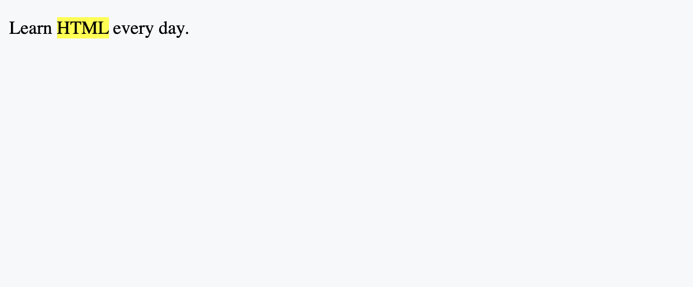

<!-- Add your output screenshot here. Recommended size: 600 × 150 px -->

<a id="delete-and-insert-tags"></a>

## Delete and Insert Tags

`<del>` deleted text ko represent karta hai.

`<ins>` inserted text ko represent karta hai.

```html
<p>Old Price: <del>₹1000</del></p>

<p>New Price: <ins>₹800</ins></p>
```

**Output :**

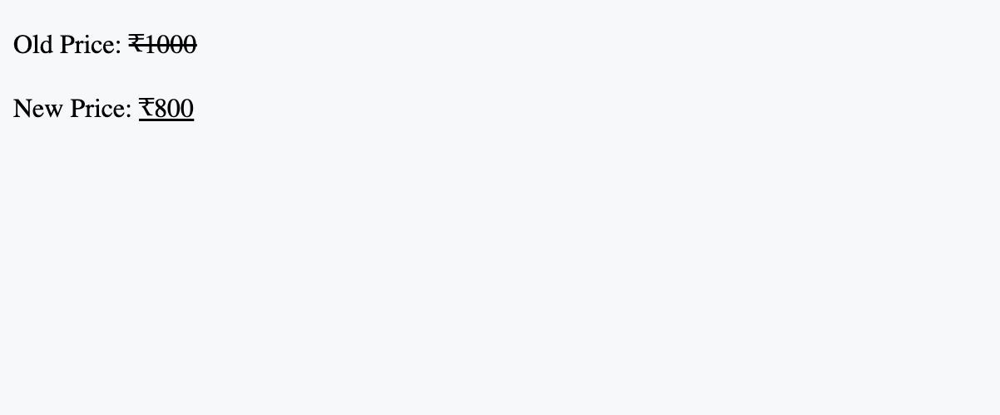

<!-- Add your output screenshot here. Recommended size: 600 × 150 px -->

<a id="subscript-and-superscript"></a>

## Subscript and Superscript

`<sub>` text ko baseline se neeche display karta hai.

`<sup>` text ko baseline se upar display karta hai.

```html
<p>Water Formula: H<sub>2</sub>O</p>

<p>Square: 10<sup>2</sup> = 100</p>
```

**Output :**

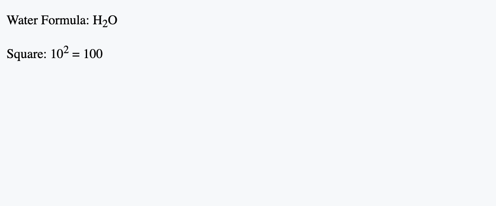

<!-- Add your output screenshot here. Recommended size: 600 × 150 px -->

<a id="pre-tag"></a>

## Pre Tag

`<pre>` preformatted text display karta hai. Ismein spaces aur line breaks preserve rehte hain.

```html
<pre>
Name: Sumit
Course: Web Development
Subject: HTML
</pre>
```

**Output :**

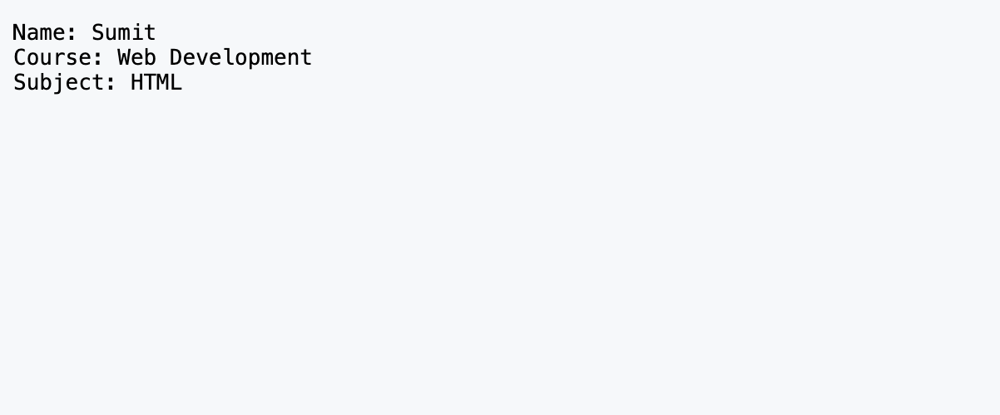

<!-- Add your output screenshot here. Recommended size: 600 × 200 px -->

<a id="code-and-keyboard-tags"></a>

## Code and Keyboard Tags

`<code>` computer code ko represent karta hai.

`<kbd>` keyboard input ko represent karta hai.

```html
<p>Use <code>console.log()</code> in JavaScript.</p>

<p>Press <kbd>Ctrl</kbd> + <kbd>S</kbd> to save.</p>
```

**Output :**

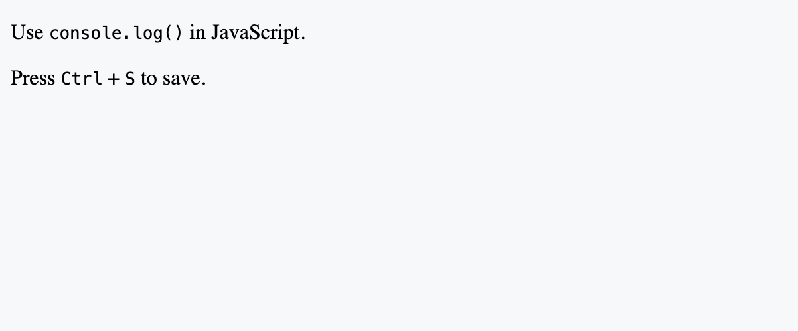 

<!-- Add your output screenshot here. Recommended size: 600 × 150 px -->

<a id="blockquote-and-q-tags"></a>

## Blockquote and Q Tags

`<blockquote>` long quotation ko represent karta hai.

`<q>` short inline quotation ko represent karta hai.

```html
<blockquote>
    Learning never stops.
</blockquote>

<p>He said, <q>Practice makes progress.</q></p>
```

**Output :**

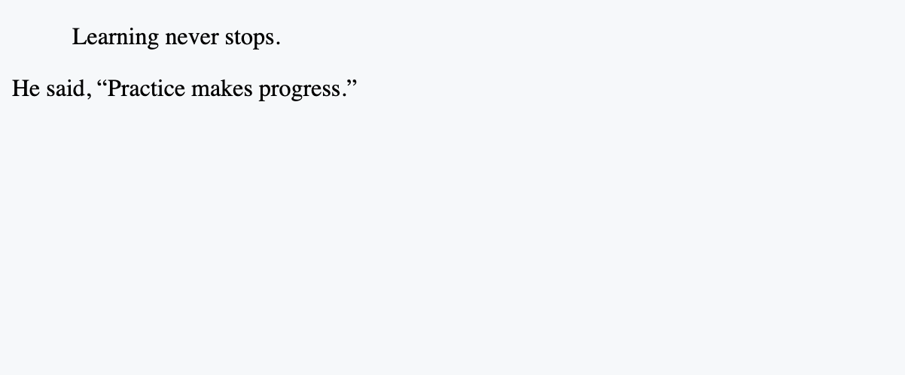

<!-- Add your output screenshot here. Recommended size: 600 × 200 px -->

<a id="abbreviation-tag"></a>

## Abbreviation Tag

`<abbr>` abbreviation ya short form ko represent karta hai.

`title` attribute mein full form ya explanation provide kar sakte hain.

```html
<p>
    <abbr title="HyperText Markup Language">HTML</abbr>
    is used to create webpages.
</p>
```

**Output :**

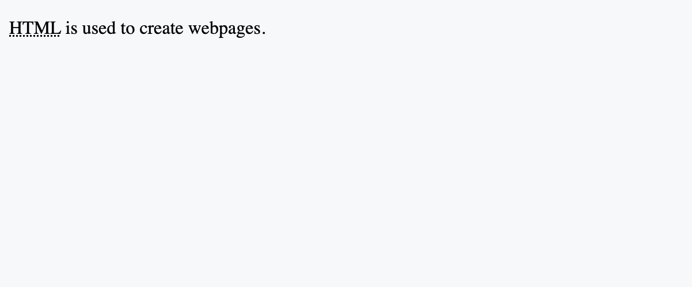

<!-- Add your output screenshot here. Recommended size: 600 × 150 px -->

---

# 5. HTML Links and Navigation

<a id="anchor-tag"></a>

## Anchor Tag

`<a>` tag ka use hyperlinks create karne ke liye hota hai.

`href` attribute destination define karta hai.

```html
<a href="https://www.google.com">Visit Google</a>
```

**Output :**


<!-- Add your output screenshot here. Recommended size: 600 × 150 px -->

<a id="external-links"></a>

## External Links

External link kisi doosri website par le jaata hai.

```html
<a href="https://www.wikipedia.org">Visit Wikipedia</a>
```

<a id="internal-page-links"></a>

## Internal Page Links

Internal link same website ke kisi doosre page ko open karta hai.

```html
<a href="about.html">About Us</a>

<a href="contact.html">Contact Us</a>
```

<a id="target-attribute"></a>

## Target Attribute

`target` attribute decide karta hai ki link kahan open hoga.

| Value | Purpose |
|---|---|
| `_self` | Same browsing context |
| `_blank` | New tab or window |

```html
<a href="https://www.google.com" target="_self">
    Same Tab
</a>

<a href="https://www.google.com"
   target="_blank"
   rel="noopener noreferrer">
    New Tab
</a>
```

**Output :**


<!-- Add your output screenshot here. Recommended size: 600 × 150 px -->

<a id="email-links"></a>

## Email Links

`mailto:` ka use email link create karne ke liye hota hai.

```html
<a href="mailto:hello@example.com">Send Email</a>
```

<a id="telephone-links"></a>

## Telephone Links

`tel:` ka use phone call link create karne ke liye hota hai.

```html
<a href="tel:+911234567890">Call Us</a>
```

<a id="download-links"></a>

## Download Links

`download` attribute linked file ko download karne ke liye use hota hai.

```html
<a href="notes.pdf" download>Download Notes</a>
```

<a id="links-to-page-sections"></a>

## Links to Page Sections

`id` aur `href="#id-name"` ki help se same webpage ke kisi particular section par ja sakte hain.

```html
<a href="#about">Go to About Section</a>

<h2 id="about">About Us</h2>

<p>Welcome to our website.</p>
```

<a id="image-as-a-link"></a>

## Image as a Link

Image ko anchor tag ke andar rakhkar clickable banaya ja sakta hai.

```html
<a href="https://www.google.com">
    
</a>
```

**Output :**


<!-- Add your output screenshot here. Recommended size: 600 × 200 px -->

---

# 6. HTML Images

<a id="image-tag"></a>

## Image Tag

`` tag ka use webpage par images display karne ke liye hota hai.

```html

```

<a id="image-attributes"></a>

## Image Attributes

| Attribute | Purpose |
|---|---|
| src | Image location |
| alt | Image description |
| width | Image width |
| height | Image height |
| loading | Loading behavior |

```html

```

**Output :**


<!-- Add your output screenshot here. Recommended size: 600 × 300 px -->

<a id="image-file-paths"></a>

## Image File Paths

Image ko HTML document se connect karne ke liye correct file path dena zaroori hai.

Example folder structure:

```text
website/
│
├── index.html
│
└── images/
    ├── laptop.jpg
    └── phone.jpg
```

HTML code:

```html


```

<a id="absolute-and-relative-paths"></a>

## Absolute and Relative Paths

**Absolute Path:** Complete URL ya full resource address hota hai.

```html

```

**Relative Path:** Current file ke relation mein resource ka location hota hai.

```html

```

<a id="figure-and-figcaption"></a>

## Figure and Figcaption

`<figure>` image ya illustration ko group karta hai.

`<figcaption>` uska caption provide karta hai.

```html
<figure>
    

    <figcaption>Beautiful Red Flower</figcaption>
</figure>
```

**Output :**


<!-- Add your output screenshot here. Recommended size: 600 × 250 px -->

<a id="lazy-loading"></a>

## Lazy Loading

`loading="lazy"` browser ko image ko tab load karne ki permission deta hai jab image viewport ke paas aati hai.

Isse initial page loading performance improve ho sakti hai.

```html

```

<a id="responsive-images"></a>

## Responsive Images

`srcset` aur `sizes` attributes browser ko different screen sizes aur resolutions ke liye suitable image choose karne mein help karte hain.

```html

```

<a id="picture-and-source-tags"></a>

## Picture and Source Tags

`<picture>` different screen conditions ke liye multiple image sources provide karta hai.

```html
<picture>
    <source
        media="(max-width: 600px)"
        srcset="mobile.jpg"
    >

    <source
        media="(min-width: 601px)"
        srcset="desktop.jpg"
    >

    
</picture>
```

**Output :**


<!-- Add your output screenshot here. Recommended size: 600 × 300 px -->

---

# 7. HTML Lists

<a id="unordered-list"></a>

## Unordered List

`<ul>` unordered list create karta hai. Items generally bullet points ke saath display hote hain.

`<li>` list item define karta hai.

```html
<ul>
    <li>HTML</li>
    <li>CSS</li>
    <li>JavaScript</li>
</ul>
```

**Output :**


<!-- Add your output screenshot here. Recommended size: 600 × 250 px -->

<a id="ordered-list"></a>

## Ordered List

`<ol>` ordered list create karta hai. Items generally numbers ke saath display hote hain.

```html
<ol>
    <li>Learn HTML</li>
    <li>Learn CSS</li>
    <li>Learn JavaScript</li>
</ol>
```

**Output :**


<!-- Add your output screenshot here. Recommended size: 600 × 250 px -->

<a id="description-list"></a>

## Description List

`<dl>` description list create karta hai.

- `<dt>` term define karta hai.
- `<dd>` term ki description define karta hai.

```html
<dl>
    <dt>HTML</dt>
    <dd>Structure of a webpage.</dd>

    <dt>CSS</dt>
    <dd>Styling of a webpage.</dd>
</dl>
```

**Output :**


<!-- Add your output screenshot here. Recommended size: 600 × 250 px -->

<a id="nested-lists"></a>

## Nested Lists

Ek list ke andar doosri list ko nested list kehte hain.

```html
<ul>
    <li>Frontend
        <ul>
            <li>HTML</li>
            <li>CSS</li>
            <li>JavaScript</li>
        </ul>
    </li>

    <li>Backend</li>
</ul>
```

**Output :**


<!-- Add your output screenshot here. Recommended size: 600 × 250 px -->

---

# 8. HTML Tables

<a id="table-tag"></a>

## Table Tag

`<table>` tag ka use data ko rows aur columns mein organize karne ke liye hota hai.

<a id="table-rows-and-cells"></a>

## Table Rows and Cells

- `<tr>` table row create karta hai.
- `<td>` normal data cell create karta hai.

```html
<table border="1">
    <tr>
        <td>Sumit</td>
        <td>19</td>
    </tr>

    <tr>
        <td>Rahul</td>
        <td>20</td>
    </tr>
</table>
```

**Output :**


<!-- Add your output screenshot here. Recommended size: 600 × 250 px -->

<a id="table-headings"></a>

## Table Headings

`<th>` table heading cell create karta hai.

```html
<table border="1">
    <tr>
        <th>Name</th>
        <th>Age</th>
        <th>City</th>
    </tr>

    <tr>
        <td>Sumit</td>
        <td>19</td>
        <td>Delhi</td>
    </tr>
</table>
```

**Output :**


<!-- Add your output screenshot here. Recommended size: 600 × 250 px -->

<a id="table-caption"></a>

## Table Caption

`<caption>` table ka title ya description provide karta hai.

```html
<table border="1">
    <caption>Student Details</caption>

    <tr>
        <th>Name</th>
        <th>Age</th>
    </tr>

    <tr>
        <td>Sumit</td>
        <td>19</td>
    </tr>
</table>
```

<a id="colspan-attribute"></a>

## Colspan Attribute

`colspan` ek cell ko multiple columns mein expand karta hai.

```html
<table border="1">
    <tr>
        <th colspan="2">Student Details</th>
    </tr>

    <tr>
        <td>Name</td>
        <td>Sumit</td>
    </tr>
</table>
```

**Output Screenshot Size:** 600 × 200 px

<!-- Add your output screenshot here. Recommended size: 600 × 200 px -->

<a id="rowspan-attribute"></a>

## Rowspan Attribute

`rowspan` ek cell ko multiple rows mein expand karta hai.

```html
<table border="1">
    <tr>
        <th>Name</th>
        <td>Sumit</td>
    </tr>

    <tr>
        <th rowspan="2">Course</th>
        <td>HTML</td>
    </tr>

    <tr>
        <td>CSS</td>
    </tr>
</table>
```

**Output Screenshot Size:** 600 × 250 px

<!-- Add your output screenshot here. Recommended size: 600 × 250 px -->

<a id="table-sections"></a>

## Table Sections

Tables ko logically organize karne ke liye teen important tags use hote hain:

| Tag | Purpose |
|---|---|
| `<thead>` | Header section |
| `<tbody>` | Body section |
| `<tfoot>` | Footer section |

```html
<table border="1">

    <thead>
        <tr>
            <th>Product</th>
            <th>Price</th>
        </tr>
    </thead>

    <tbody>
        <tr>
            <td>Keyboard</td>
            <td>500</td>
        </tr>

        <tr>
            <td>Mouse</td>
            <td>300</td>
        </tr>
    </tbody>

    <tfoot>
        <tr>
            <td>Total</td>
            <td>800</td>
        </tr>
    </tfoot>

</table>
```

**Output Screenshot Size:** 600 × 250 px

<!-- Add your output screenshot here. Recommended size: 600 × 250 px -->

<a id="accessible-tables"></a>

## Accessible Tables

Table headings aur data ko properly connect karne se screen readers ko table samajhne mein help milti hai.

```html
<table>
    <caption>Student Marks</caption>

    <thead>
        <tr>
            <th scope="col">Name</th>
            <th scope="col">Marks</th>
        </tr>
    </thead>

    <tbody>
        <tr>
            <th scope="row">Sumit</th>
            <td>85</td>
        </tr>
    </tbody>
</table>
```

---

# 9. HTML Forms

<a id="form-tag"></a>

## Form Tag

`<form>` tag user se information collect karne ke liye form create karta hai.

```html
<form>
    <label>Name:</label>

    <input type="text">

    <button type="submit">Submit</button>
</form>
```

**Output Screenshot Size:** 600 × 200 px

<!-- Add your output screenshot here. Recommended size: 600 × 200 px -->

<a id="label-tag"></a>

## Label Tag

`<label>` input field ka naam ya description provide karta hai.

`for` attribute ki value input ke `id` se match honi chahiye.

```html
<form>
    <label for="username">Username:</label>

    <input type="text" id="username">
</form>
```

<a id="input-tag"></a>

## Input Tag

`<input>` tag user se data receive karne ke liye use hota hai.

```html
<form>
    <input type="text" placeholder="Enter name">

    <input type="email" placeholder="Enter email">

    <input type="password" placeholder="Enter password">
</form>
```

**Output Screenshot Size:** 600 × 200 px

<!-- Add your output screenshot here. Recommended size: 600 × 200 px -->

<a id="input-types"></a>

## Input Types

`type` attribute decide karta hai ki input field kis tarah ka data accept karega.

| Input Type | Purpose |
|---|---|
| text | Normal text |
| password | Password |
| email | Email address |
| number | Number |
| tel | Telephone number |
| url | Website URL |
| date | Date selection |
| time | Time selection |
| datetime-local | Local date and time |
| month | Month selection |
| week | Week selection |
| checkbox | Multiple choices |
| radio | Single choice |
| file | File upload |
| color | Color selection |
| range | Range selection |
| search | Search input |
| submit | Form submit |
| reset | Form reset |
| button | Normal button |
| hidden | Hidden input |

<a id="text-and-password-inputs"></a>

## Text and Password Inputs

`type="text"` normal text receive karta hai.

`type="password"` password field create karta hai jisme entered characters generally hide hote hain.

```html
<form>
    <input type="text" placeholder="Enter username">

    <input type="password" placeholder="Enter password">
</form>
```

**Output Screenshot Size:** 600 × 200 px

<!-- Add your output screenshot here. Recommended size: 600 × 200 px -->

<a id="email-and-url-inputs"></a>

## Email and URL Inputs

`type="email"` email address ke liye input provide karta hai.

`type="url"` website URL ke liye input provide karta hai.

```html
<form>
    <input type="email" placeholder="Enter email">

    <input type="url" placeholder="Enter website URL">
</form>
```

<a id="number-and-range-inputs"></a>

## Number and Range Inputs

`type="number"` numeric value receive karta hai.

`type="range"` range control provide karta hai.

```html
<form>
    <input type="number" min="1" max="100">

    <input type="range" min="0" max="100">
</form>
```

**Output Screenshot Size:** 600 × 200 px

<!-- Add your output screenshot here. Recommended size: 600 × 200 px -->

<a id="date-and-time-inputs"></a>

## Date and Time Inputs

Date aur time ke liye different input types available hain.

```html
<form>
    <input type="date">

    <input type="time">

    <input type="datetime-local">

    <input type="month">

    <input type="week">
</form>
```

**Output Screenshot Size:** 600 × 250 px

<!-- Add your output screenshot here. Recommended size: 600 × 250 px -->

<a id="radio-buttons"></a>

## Radio Buttons

Radio buttons ka use ek group mein se ek option select karne ke liye hota hai.

Same group ke radio buttons mein same `name` attribute hona chahiye.

```html
<form>
    <p>Select Gender:</p>

    <input type="radio" id="male" name="gender" value="male">
    <label for="male">Male</label>

    <input type="radio" id="female" name="gender" value="female">
    <label for="female">Female</label>
</form>
```

**Output Screenshot Size:** 600 × 200 px

<!-- Add your output screenshot here. Recommended size: 600 × 200 px -->

<a id="checkboxes"></a>

## Checkboxes

Checkboxes ka use multiple options select karne ke liye hota hai.

```html
<form>
    <p>Select Skills:</p>

    <input type="checkbox" id="html" name="skills" value="HTML">
    <label for="html">HTML</label>

    <input type="checkbox" id="css" name="skills" value="CSS">
    <label for="css">CSS</label>

    <input type="checkbox" id="js" name="skills" value="JavaScript">
    <label for="js">JavaScript</label>
</form>
```

**Output Screenshot Size:** 600 × 200 px

<!-- Add your output screenshot here. Recommended size: 600 × 200 px -->

<a id="file-input"></a>

## File Input

`type="file"` user ko file select karne ki permission deta hai.

```html
<form>
    <label for="resume">Upload Resume:</label>

    <input type="file" id="resume" name="resume">
</form>
```

Multiple files allow karne ke liye `multiple` attribute use kar sakte hain.

```html
<input type="file" multiple>
```

<a id="select-and-option"></a>

## Select and Option

`<select>` dropdown list create karta hai.

`<option>` dropdown ke choices define karta hai.

```html
<form>
    <label for="city">Select City:</label>

    <select id="city" name="city">

        <option value="delhi">Delhi</option>

        <option value="mumbai">Mumbai</option>

        <option value="jaipur">Jaipur</option>

    </select>
</form>
```

**Output Screenshot Size:** 600 × 200 px

<!-- Add your output screenshot here. Recommended size: 600 × 200 px -->

<a id="textarea"></a>

## Textarea

`<textarea>` multiple lines mein text enter karne ke liye use hota hai.

```html
<form>
    <label for="message">Your Message:</label>

    <textarea
        id="message"
        name="message"
        rows="5"
        cols="30"
        placeholder="Write your message">
    </textarea>
</form>
```

**Output Screenshot Size:** 600 × 250 px

<!-- Add your output screenshot here. Recommended size: 600 × 250 px -->

<a id="button-tag"></a>

## Button Tag

`<button>` clickable button create karta hai.

| Type | Purpose |
|---|---|
| submit | Form submit |
| reset | Form reset |
| button | Normal button |

```html
<form>
    <button type="submit">Submit</button>

    <button type="reset">Reset</button>

    <button type="button">Click Me</button>
</form>
```

**Output Screenshot Size:** 600 × 200 px

<!-- Add your output screenshot here. Recommended size: 600 × 200 px -->

<a id="fieldset-and-legend"></a>

## Fieldset and Legend

`<fieldset>` related form controls ko group karta hai.

`<legend>` us group ka title provide karta hai.

```html
<form>
    <fieldset>

        <legend>Personal Information</legend>

        <label for="name">Name:</label>

        <input type="text" id="name">

        <label for="email">Email:</label>

        <input type="email" id="email">

    </fieldset>
</form>
```

**Output Screenshot Size:** 600 × 250 px

<!-- Add your output screenshot here. Recommended size: 600 × 250 px -->

<a id="input-attributes"></a>

## Input Attributes

Important input attributes:

| Attribute | Purpose |
|---|---|
| placeholder | Input hint |
| value | Default value |
| name | Input field name |
| required | Field compulsory |
| readonly | Value edit nahi hogi |
| disabled | Field inactive |
| min | Minimum value |
| max | Maximum value |
| step | Value interval |
| maxlength | Maximum text length |
| minlength | Minimum text length |
| pattern | Input format |
| autocomplete | Browser suggestions |
| autofocus | Automatic focus |
| multiple | Multiple values/files |

<a id="form-attributes"></a>

## Form Attributes

| Attribute | Purpose |
|---|---|
| action | Form submission destination |
| method | HTTP method |
| name | Form name |
| target | Response location |
| autocomplete | Autocomplete behavior |
| enctype | Form data encoding |
| novalidate | Browser validation disable |

```html
<form action="/submit" method="post">

    <label for="username">Name:</label>

    <input
        type="text"
        id="username"
        name="username"
        required
    >

    <button type="submit">Submit</button>

</form>
```

<a id="form-validation"></a>

## Form Validation

HTML browser ke through basic form validation provide karta hai.

```html
<form>
    <label for="email">Email:</label>

    <input
        type="email"
        id="email"
        required
    >

    <button type="submit">Submit</button>
</form>
```

Browser required fields aur supported input formats check kar sakta hai.

**Important:** Client-side validation security ka replacement nahi hai. Server par bhi validation karna zaroori hai.

---

# 10. HTML Layout and Semantic Elements

<a id="div-tag"></a>

## Div Tag

`<div>` generic block-level container hai. Iska use related HTML elements ko group karne ke liye hota hai.

```html
<div>
    <h2>About Us</h2>

    <p>We create websites.</p>
</div>
```

**Output Screenshot Size:** 600 × 200 px

<!-- Add your output screenshot here. Recommended size: 600 × 200 px -->

<a id="span-tag"></a>

## Span Tag

`<span>` generic inline container hai. Iska use text ke kisi small part ko group karne ke liye hota hai.

```html
<p>
    My favorite color is
    <span>blue</span>.
</p>
```

**Output Screenshot Size:** 600 × 150 px

<!-- Add your output screenshot here. Recommended size: 600 × 150 px -->

<a id="header-tag"></a>

## Header Tag

`<header>` page ya section ke introductory content ko represent karta hai.

```html
<header>
    <h1>My Website</h1>

    <p>Welcome to my website.</p>
</header>
```

<a id="nav-tag"></a>

## Nav Tag

`<nav>` navigation links ko group karne ke liye use hota hai.

```html
<nav>
    <a href="index.html">Home</a>

    <a href="about.html">About</a>

    <a href="contact.html">Contact</a>
</nav>
```

<a id="main-tag"></a>

## Main Tag

`<main>` webpage ke main content ko represent karta hai.

```html
<main>
    <h1>Welcome</h1>

    <p>This is the main content.</p>
</main>
```

<a id="section-tag"></a>

## Section Tag

`<section>` related content ko ek meaningful section mein organize karta hai.

```html
<section>
    <h2>Our Services</h2>

    <p>We provide web development services.</p>
</section>
```

<a id="article-tag"></a>

## Article Tag

`<article>` independent aur self-contained content ko represent karta hai.

Examples: Blog post, news article aur product review.

```html
<article>
    <h2>Introduction to HTML</h2>

    <p>HTML is used to create webpages.</p>
</article>
```

<a id="aside-tag"></a>

## Aside Tag

`<aside>` main content se related additional information ko represent karta hai.

```html
<aside>
    <h3>Related Topics</h3>

    <ul>
        <li>HTML</li>
        <li>CSS</li>
    </ul>
</aside>
```

<a id="footer-tag"></a>

## Footer Tag

`<footer>` page ya section ki ending information ko represent karta hai.

```html
<footer>
    <p>Copyright © 2026 My Website</p>

    <a href="contact.html">Contact Us</a>
</footer>
```

<a id="semantic-html"></a>

## Semantic HTML

Semantic HTML mein meaningful elements use kiye jaate hain jo content ka purpose clearly define karte hain.

Common semantic elements:

- `<header>`
- `<nav>`
- `<main>`
- `<section>`
- `<article>`
- `<aside>`
- `<footer>`

```html
<header>
    <h1>My Website</h1>
</header>

<nav>
    <a href="#home">Home</a>
    <a href="#about">About</a>
</nav>

<main>

    <section id="about">
        <h2>About Us</h2>
        <p>Welcome to our website.</p>
    </section>

    <article>
        <h2>Latest News</h2>
        <p>Our website is live.</p>
    </article>

</main>

<footer>
    <p>Copyright 2026</p>
</footer>
```

**Output Screenshot Size:** 600 × 350 px

<!-- Add your output screenshot here. Recommended size: 600 × 350 px -->

---

# 11. HTML Media

<a id="audio-tag"></a>

## Audio Tag

`<audio>` tag webpage par audio play karne ke liye use hota hai.

```html
<audio controls>
    <source src="music.mp3" type="audio/mpeg">

    Your browser does not support audio.
</audio>
```

<a id="video-tag"></a>

## Video Tag

`<video>` tag webpage par video display aur play karne ke liye use hota hai.

```html
<video width="400" controls>

    <source src="video.mp4" type="video/mp4">

    Your browser does not support video.

</video>
```

**Output Screenshot Size:** 600 × 300 px

<!-- Add your output screenshot here. Recommended size: 600 × 300 px -->

<a id="source-tag"></a>

## Source Tag

`<source>` audio, video aur picture elements ke liye multiple resource sources provide karta hai.

```html
<video controls width="400">

    <source src="video.mp4" type="video/mp4">

    <source src="video.webm" type="video/webm">

</video>
```

<a id="track-tag"></a>

## Track Tag

`<track>` video ya audio ke liye text tracks provide karta hai, jaise subtitles aur captions.

```html
<video controls width="400">

    <source src="video.mp4" type="video/mp4">

    <track
        src="subtitles.vtt"
        kind="subtitles"
        srclang="en"
        label="English"
    >

</video>
```

<a id="iframe-tag"></a>

## Iframe Tag

`<iframe>` kisi doosre webpage ya supported external content ko current webpage ke andar embed karta hai.

```html
<iframe
    src="https://example.com"
    width="500"
    height="300"
    title="Example Website">
</iframe>
```

**Output Screenshot Size:** 600 × 350 px

<!-- Add your output screenshot here. Recommended size: 600 × 350 px -->

<a id="embedding-youtube-videos"></a>

## Embedding YouTube Videos

YouTube videos ko embed karne ke liye iframe use kiya ja sakta hai.

```html
<iframe
    width="560"
    height="315"
    src="https://www.youtube.com/embed/VIDEO_ID"
    title="YouTube video player"
    allowfullscreen>
</iframe>
```

`VIDEO_ID` ko actual YouTube video ID se replace karna hota hai.

---

# 12. HTML Head and Metadata

<a id="title-tag"></a>

## Title Tag

`<title>` browser tab mein webpage ka title show karta hai.

```html
<head>
    <title>My First Website</title>
</head>
```

<a id="meta-charset"></a>

## Meta Charset

`charset="UTF-8"` document ki character encoding define karta hai.

```html
<meta charset="UTF-8">
```

<a id="viewport-meta-tag"></a>

## Viewport Meta Tag

Viewport meta tag webpage ko different screen sizes par properly display karne mein help karta hai.

```html
<meta name="viewport" content="width=device-width, initial-scale=1.0">
```

<a id="meta-description"></a>

## Meta Description

Meta description webpage ka short summary provide karta hai.

```html
<meta
    name="description"
    content="Learn HTML with practical examples."
>
```

<a id="meta-robots"></a>

## Meta Robots

Meta robots search engines ko crawling aur indexing ke instructions provide kar sakta hai.

```html
<meta name="robots" content="index, follow">
```

<a id="link-tag"></a>

## Link Tag

`<link>` external resources ko HTML document se connect karta hai.

Common use CSS file connect karna hai.

```html
<link rel="stylesheet" href="style.css">
```

<a id="favicon"></a>

## Favicon

Favicon browser tab mein website ke saath display hone wala small icon hota hai.

```html
<link rel="icon" href="favicon.ico">
```

<a id="script-tag"></a>

## Script Tag

`<script>` JavaScript add ya external JavaScript file connect karta hai.

```html
<script src="script.js"></script>
```

<a id="base-tag"></a>

## Base Tag

`<base>` document ke relative URLs ke liye base URL ya default target define karta hai.

```html
<head>
    <base href="https://example.com/">
</head>
```

**Note:** Ek document mein maximum ek `<base>` element use hota hai.

---

# 13. Important HTML Attributes

<a id="id-attribute"></a>

## ID Attribute

`id` kisi HTML element ko unique identity provide karta hai.

```html
<h1 id="main-heading">Welcome</h1>
```

<a id="class-attribute"></a>

## Class Attribute

`class` multiple elements ko ek group mein identify karne ke liye use hota hai.

```html
<p class="intro">First Paragraph</p>

<p class="intro">Second Paragraph</p>
```

<a id="style-attribute"></a>

## Style Attribute

`style` attribute element par inline CSS apply karta hai.

```html
<p style="color: blue;">Blue Text</p>
```

<a id="title-attribute"></a>

## Title Attribute

`title` element ke baare mein additional information provide karta hai.

```html
<p title="Additional information">
    Move your mouse over this text.
</p>
```

<a id="hidden-attribute"></a>

## Hidden Attribute

`hidden` attribute element ko normally browser display se hide karta hai.

```html
<p hidden>This text is hidden.</p>
```

<a id="contenteditable-attribute"></a>

## Contenteditable Attribute

`contenteditable` attribute element ke content ko browser mein editable banata hai.

```html
<p contenteditable="true">
    You can edit this text.
</p>
```

<a id="data-attributes"></a>

## Data Attributes

`data-*` custom data ko HTML elements mein store karne ke liye use hote hain.

```html
<div data-product-id="101">
    Product Name
</div>
```

<a id="min-and-max-attributes"></a>

## Min and Max Attributes

`min` aur `max` input ki minimum aur maximum allowed values define karte hain.

```html
<input type="number" min="1" max="100">
```

<a id="step-attribute"></a>

## Step Attribute

`step` numeric input ke allowed intervals define karta hai.

```html
<input type="number" min="0" max="100" step="5">
```

<a id="readonly-and-disabled"></a>

## Readonly and Disabled

`readonly` field ki value ko edit hone se rokta hai.

`disabled` field ko inactive karta hai.

```html
<input type="text" value="HTML" readonly>

<input type="text" value="CSS" disabled>
```

**Important Difference:**

- Readonly field form submission mein include ho sakta hai.
- Disabled field normal form submission mein include nahi hota.

<a id="autocomplete-attribute"></a>

## Autocomplete Attribute

`autocomplete` browser ko previously entered information suggest karne ki permission deta hai.

```html
<input type="email" autocomplete="email">
```

<a id="autofocus-attribute"></a>

## Autofocus Attribute

`autofocus` page load hone par kisi input field ko automatically focus karta hai.

```html
<input type="text" autofocus>
```

<a id="required-attribute"></a>

## Required Attribute

`required` field ko compulsory banata hai.

```html
<input type="email" required>
```

<a id="pattern-attribute"></a>

## Pattern Attribute

`pattern` attribute input value ke liye regular-expression based format define karta hai.

```html
<input
    type="text"
    pattern="[A-Za-z]{3,}"
    title="Enter at least 3 letters"
>
```

---

# 14. HTML Entities

HTML Entities ka use special characters ko webpage par display karne ke liye hota hai.

| Entity | Output | Purpose |
|---|---|---|
| `&lt;` | < | Less than |
| `&gt;` | > | Greater than |
| `&amp;` | & | Ampersand |
| `&nbsp;` | Non-breaking space | Space |
| `&copy;` | © | Copyright |
| `&reg;` | ® | Registered |
| `&trade;` | ™ | Trademark |
| `&quot;` | " | Double quote |
| `&apos;` | ' | Apostrophe |
| `&euro;` | € | Euro |
| `&pound;` | £ | Pound |
| `&yen;` | ¥ | Yen |

**Example:**

```html
<p>5 &lt; 10</p>

<p>10 &gt; 5</p>

<p>Tom &amp; Jerry</p>

<p>Copyright &copy; 2026</p>
```

**Output Screenshot Size:** 600 × 200 px

<!-- Add your output screenshot here. Recommended size: 600 × 200 px -->

---

# 15. HTML Accessibility

<a id="alt-attribute"></a>

## Alt Attribute

`alt` attribute image ka text description provide karta hai.

Image load na hone par ya screen reader use karne par alt text helpful hota hai.

```html

```

<a id="accessible-images"></a>

## Accessible Images

Images ke liye meaningful alt text provide karna chahiye.

Decorative images ke liye empty alt text use kiya ja sakta hai.

```html


```

<a id="accessible-forms"></a>

## Accessible Forms

Form inputs ke saath proper labels use karna chahiye.

```html
<label for="email">Email Address:</label>

<input type="email" id="email" name="email">
```

<a id="aria-attributes"></a>

## ARIA Attributes

ARIA attributes assistive technologies ko elements ka purpose aur state samajhne mein help karte hain.

```html
<button aria-label="Close menu">
    X
</button>
```

Common ARIA attributes:

| Attribute | Purpose |
|---|---|
| aria-label | Accessible name |
| aria-hidden | Assistive technology se hide |
| aria-expanded | Expanded state |
| aria-controls | Controlled element |
| aria-describedby | Additional description |
| aria-live | Dynamic updates announce karna |

**Note:** Native HTML elements aur proper labels ko priority do. ARIA ka use tab karo jab native HTML required accessibility information provide nahi karta.

---

# 16. HTML SEO

<a id="what-is-seo"></a>

## What is SEO?

SEO stands for Search Engine Optimization.

SEO ka purpose website ke content ko search engines ke liye understandable aur discoverable banana hai.

<a id="html-and-seo"></a>

## HTML and SEO

HTML ki proper structure search engines ko webpage ka content samajhne mein help karti hai.

Important HTML elements:

- Title tag
- Meta description
- Heading tags
- Semantic elements
- Image alt attributes
- Descriptive links

<a id="seo-friendly-headings"></a>

## SEO Friendly Headings

Headings content ko logically organize karti hain.

```html
<h1>Web Development Course</h1>

<h2>HTML Course</h2>

<p>Learn HTML fundamentals.</p>

<h2>CSS Course</h2>

<p>Learn website styling.</p>
```

<a id="meta-description-for-seo"></a>

## Meta Description for SEO

Meta description webpage ka short summary provide karta hai.

```html
<meta
    name="description"
    content="Learn HTML with simple explanations and practical examples."
>
```

<a id="image-seo"></a>

## Image SEO

Images ke liye meaningful file names aur alt text use karo.

```html

```

<a id="canonical-link"></a>

## Canonical Link

Canonical link search engines ko preferred URL identify karne mein help karta hai.

```html
<link
    rel="canonical"
    href="https://example.com/html-course"
>
```

---

# 17. Useful HTML Elements

<a id="details-and-summary"></a>

## Details and Summary

`<details>` expandable information create karta hai.

`<summary>` uska visible heading hota hai.

```html
<details>
    <summary>What is HTML?</summary>

    <p>HTML is a markup language.</p>
</details>
```

**Output Screenshot Size:** 600 × 200 px

<!-- Add your output screenshot here. Recommended size: 600 × 200 px -->

<a id="progress-tag"></a>

## Progress Tag

`<progress>` kisi task ki progress show karta hai.

```html
<label for="download">Download Progress:</label>

<progress id="download" value="70" max="100"></progress>
```

**Output Screenshot Size:** 600 × 150 px

<!-- Add your output screenshot here. Recommended size: 600 × 150 px -->

<a id="meter-tag"></a>

## Meter Tag

`<meter>` ek known range ke andar measurement show karta hai.

```html
<label for="storage">Storage Usage:</label>

<meter id="storage" value="6" min="0" max="10"></meter>
```

**Output Screenshot Size:** 600 × 150 px

<!-- Add your output screenshot here. Recommended size: 600 × 150 px -->

<a id="time-tag"></a>

## Time Tag

`<time>` date ya time ko machine-readable format mein represent karta hai.

```html
<p>
    Published on
    <time datetime="2026-11-22">22 November 2026</time>
</p>
```

<a id="address-tag"></a>

## Address Tag

`<address>` contact information provide karta hai.

```html
<address>
    Contact: hello@example.com

    <br>

    Delhi, India
</address>
```

<a id="dialog-tag"></a>

## Dialog Tag

`<dialog>` dialog box ya modal window represent karta hai.

```html
<dialog open>
    <p>This is a dialog box.</p>
</dialog>
```

**Output Screenshot Size:** 600 × 200 px

<!-- Add your output screenshot here. Recommended size: 600 × 200 px -->

<a id="template-tag"></a>

## Template Tag

`<template>` reusable HTML content define karta hai jo page load hote hi normally display nahi hota.

```html
<template id="product-template">

    <div>
        <h2>Product Name</h2>

        <p>Product Description</p>
    </div>

</template>
```

Template content ko JavaScript se access aur use kiya ja sakta hai.

---

# 18. HTML Forms and Browser APIs

<a id="form-validation-api"></a>

## Form Validation

HTML forms browser ki built-in validation provide karte hain.

```html
<form>

    <input
        type="email"
        required
        placeholder="Enter email"
    >

    <button type="submit">Submit</button>

</form>
```

<a id="input-validation-states"></a>

## Input Validation States

Browser input ki validity check kar sakta hai.

Common validation concepts:

- `required`
- `min`
- `max`
- `minlength`
- `maxlength`
- `pattern`
- Input type validation

```html
<form>

    <input
        type="text"
        minlength="3"
        maxlength="20"
        required
    >

    <button type="submit">Submit</button>

</form>
```

<a id="custom-data-attributes"></a>

## Custom Data Attributes

`data-*` attributes custom data store karte hain. JavaScript in values ko access kar sakta hai.

```html
<button data-product-id="101">
    View Product
</button>
```

JavaScript ke through:

```javascript
const button = document.querySelector("button");

console.log(button.dataset.productId);
```

---

# 19. HTML Best Practices

1. HTML document mein `<!DOCTYPE html>` declare karo.
2. HTML tags ko lowercase mein likho.
3. Elements ko properly close karo.
4. Code ko properly indent karo.
5. Images ke liye meaningful alt text use karo.
6. Headings ko logical order mein use karo.
7. Form fields ke saath labels use karo.
8. Semantic HTML elements ka use karo.
9. Meaningful page title likho.
10. Links ke liye descriptive text use karo.
11. Duplicate IDs avoid karo.
12. Unnecessary HTML elements avoid karo.
13. File aur folder names meaningful rakho.
14. HTML code ko readable rakho.
15. Browser mein webpage test karo.
16. HTML validator se markup check karo.
17. Decorative images ke liye appropriate empty alt text use karo.
18. Forms mein appropriate input types use karo.
19. New tab links mein security considerations ka dhyan rakho.
20. Client-side validation ke saath server-side validation bhi use karo.

---

# 20. Complete HTML Project

## Project: Personal Portfolio Website

Is project mein HTML ke important concepts use karke ek simple portfolio website create karenge.

**Project Code:**

```html
<!DOCTYPE html>
<html lang="en">

<head>

    <meta charset="UTF-8">

    <meta name="viewport" content="width=device-width, initial-scale=1.0">

    <meta
        name="description"
        content="Welcome to my personal portfolio website."
    >

    <title>My Portfolio</title>

</head>

<body>

    <!-- Header -->
    <header>

        <h1>My Portfolio</h1>

        <p>Welcome to my personal website.</p>

    </header>

    <!-- Navigation -->
    <nav>

        <a href="#home">Home</a>

        <a href="#about">About</a>

        <a href="#skills">Skills</a>

        <a href="#projects">Projects</a>

        <a href="#contact">Contact</a>

    </nav>

    <hr>

    <!-- Main Content -->
    <main>

        <!-- Home Section -->
        <section id="home">

            <h2>Hello, I am Sumit</h2>

            <p>
                I am learning web development
                and building my skills.
            </p>

            

        </section>

        <hr>

        <!-- About Section -->
        <section id="about">

            <h2>About Me</h2>

            <p>
                I am interested in technology,
                web development and creating websites.
            </p>

        </section>

        <hr>

        <!-- Skills Section -->
        <section id="skills">

            <h2>My Skills</h2>

            <ul>

                <li>HTML</li>

                <li>CSS</li>

                <li>JavaScript</li>

            </ul>

        </section>

        <hr>

        <!-- Projects Section -->
        <section id="projects">

            <h2>My Projects</h2>

            <article>

                <h3>First HTML Website</h3>

                <p>
                    My first website created using HTML.
                </p>

            </article>

            <article>

                <h3>Registration Form</h3>

                <p>
                    A basic registration form created using HTML.
                </p>

            </article>

        </section>

        <hr>

        <!-- Contact Section -->
        <section id="contact">

            <h2>Contact Me</h2>

            <form action="#" method="post">

                <label for="name">Your Name:</label>

                <input
                    type="text"
                    id="name"
                    name="name"
                    placeholder="Enter your name"
                    required
                >

                <br><br>

                <label for="email">Your Email:</label>

                <input
                    type="email"
                    id="email"
                    name="email"
                    placeholder="Enter your email"
                    required
                >

                <br><br>

                <label for="message">Your Message:</label>

                <br>

                <textarea
                    id="message"
                    name="message"
                    rows="5"
                    cols="30"
                    placeholder="Write your message"
                ></textarea>

                <br><br>

                <button type="submit">Send Message</button>

            </form>

        </section>

    </main>

    <hr>

    <!-- Footer -->
    <footer>

        <p>Copyright &copy; 2026 My Portfolio</p>

        <a href="mailto:hello@example.com">Email Me</a>

    </footer>

</body>

</html>
```

**Project Output Screenshot Size:** 600 × 500 px

<!-- Add your output screenshot here. Recommended size: 600 × 500 px -->

**Project Practice:**

1. Apni personal information add karo.
2. Apni profile image add karo.
3. Apne skills add karo.
4. Apne projects ke naam add karo.
5. Contact form create karo.
6. Navigation links test karo.
7. About aur Contact ke separate pages banao.

---

# 21. Important Questions and Answers

## What is HTML?

HTML stands for HyperText Markup Language. Iska use webpage ka structure create karne ke liye hota hai.

## Is HTML a programming language?

Nahi, HTML ek markup language hai.

## What is an HTML tag?

HTML tag angle brackets ke andar likha jaata hai. Example: `<h1>`.

## What is an HTML element?

Opening tag, content aur closing tag milkar HTML element bana sakte hain.

## What is an HTML attribute?

Attribute HTML element ko additional information provide karta hai.

## What is the purpose of DOCTYPE?

DOCTYPE browser ko document ka HTML standard batata hai.

## What is the difference between head and body?

Head mein metadata hota hai, body mein visible webpage content hota hai.

## What is the difference between div and span?

Div generic block-level container hai. Span generic inline container hai.

## What is the difference between id and class?

ID unique identity deta hai. Class multiple elements ko group karti hai.

## What is the difference between ol and ul?

OL ordered list create karta hai. UL unordered list create karta hai.

## What is the purpose of the anchor tag?

Anchor tag hyperlinks create karta hai.

## What is the purpose of the alt attribute?

Alt image ka text description provide karta hai.

## What is the difference between radio and checkbox?

Radio ek group mein single option select karne ke liye hota hai. Checkbox multiple options select karne ke liye hota hai.

## What is the purpose of the form tag?

Form tag user se information collect karne ke liye use hota hai.

## What is semantic HTML?

Semantic HTML meaningful tags use karta hai jo content ka purpose define karte hain.

## What is the purpose of iframe?

Iframe external webpage ya supported content ko current webpage mein embed karta hai.

## What is the purpose of meta viewport?

Viewport meta tag webpage ko different screen sizes par properly display karne mein help karta hai.

## What is the purpose of the required attribute?

Required attribute form field ko compulsory banata hai.

## What is the purpose of the target attribute?

Target attribute decide karta hai ki link kahan open hoga.

## What is the difference between readonly and disabled?

Readonly field edit nahi hoti, lekin form submission mein include ho sakti hai. Disabled field inactive hoti hai aur normal form submission mein include nahi hoti.

---

# 22. Quick Revision

| Tag / Attribute | Purpose |
|---|---|
| `<!DOCTYPE html>` | Document declaration |
| `html` | Root element |
| `head` | Metadata |
| `title` | Browser tab title |
| `body` | Visible content |
| `h1` to `h6` | Headings |
| `p` | Paragraph |
| `br` | Line break |
| `hr` | Thematic break |
| `a` | Hyperlink |
| `img` | Image |
| `b` | Bold presentation |
| `strong` | Important text |
| `i` | Alternate voice or mood |
| `em` | Emphasis |
| `u` | Underline |
| `small` | Small text |
| `mark` | Highlighted text |
| `del` | Deleted text |
| `ins` | Inserted text |
| `sub` | Subscript |
| `sup` | Superscript |
| `pre` | Preformatted text |
| `code` | Code text |
| `kbd` | Keyboard input |
| `blockquote` | Long quotation |
| `abbr` | Abbreviation |
| `ul` | Unordered list |
| `ol` | Ordered list |
| `li` | List item |
| `dl` | Description list |
| `dt` | Description term |
| `dd` | Description |
| `table` | Table |
| `tr` | Table row |
| `th` | Table heading cell |
| `td` | Table data cell |
| `caption` | Table caption |
| `thead` | Table header |
| `tbody` | Table body |
| `tfoot` | Table footer |
| `form` | Form |
| `label` | Input label |
| `input` | Input field |
| `select` | Dropdown |
| `option` | Dropdown option |
| `textarea` | Multi-line input |
| `button` | Button |
| `fieldset` | Form group |
| `legend` | Group title |
| `div` | Block container |
| `span` | Inline container |
| `header` | Header section |
| `nav` | Navigation |
| `main` | Main content |
| `section` | Content section |
| `article` | Independent content |
| `aside` | Additional content |
| `footer` | Footer section |
| `figure` | Figure content |
| `figcaption` | Figure caption |
| `audio` | Audio player |
| `video` | Video player |
| `source` | Media source |
| `track` | Text track |
| `iframe` | Embedded content |
| `details` | Expandable content |
| `summary` | Details heading |
| `progress` | Task progress |
| `meter` | Range measurement |
| `time` | Date and time |
| `address` | Contact information |
| `dialog` | Dialog box |
| `template` | Reusable HTML template |
| `href` | Link destination |
| `src` | Resource location |
| `alt` | Image description |
| `target` | Link opening location |
| `colspan` | Merge columns |
| `rowspan` | Merge rows |
| `required` | Compulsory input |
| `readonly` | Non-editable input |
| `disabled` | Inactive input |
| `placeholder` | Input hint |
| `autocomplete` | Browser suggestions |
| `autofocus` | Automatic focus |
| `min` | Minimum value |
| `max` | Maximum value |
| `step` | Value interval |
| `pattern` | Input format |

---

# 23. Practice Tasks

## Beginner Practice

1. Create a basic HTML webpage.
2. Create a webpage using all six heading tags.
3. Write five paragraphs.
4. Create external and internal links.
5. Add three images to a webpage.
6. Use bold, italic and underline tags.
7. Create an ordered list of five subjects.
8. Create an unordered list of five skills.
9. Create a simple student table.
10. Write an HTML page with comments.

## Intermediate Practice

1. Create a student registration form.
2. Create a login form.
3. Create a contact form.
4. Create a table using colspan and rowspan.
5. Create a webpage using semantic HTML.
6. Create a nested list.
7. Create an FAQ using details and summary.
8. Add an audio player.
9. Add a video player.
10. Create a webpage with internal navigation.

## Practical Projects

1. Personal Portfolio Website.
2. Student Registration Page.
3. Contact Us Page.
4. Product Information Page.
5. Simple Blog Article Page.
6. Restaurant Menu Page.
7. College Admission Form.
8. Product Comparison Table.
9. FAQ Webpage.
10. Multi-page Website.

---

# 24. Useful References

1. [MDN HTML Documentation](https://developer.mozilla.org/en-US/docs/Web/HTML)
2. [W3Schools HTML Tutorial](https://www.w3schools.com/html/)
3. [WHATWG HTML Standard](https://html.spec.whatwg.org/)
4. [W3C HTML Validator](https://validator.w3.org/)

---

<p align="center">
    <a href="#top">↑ Back to Top</a>
</p>